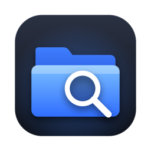
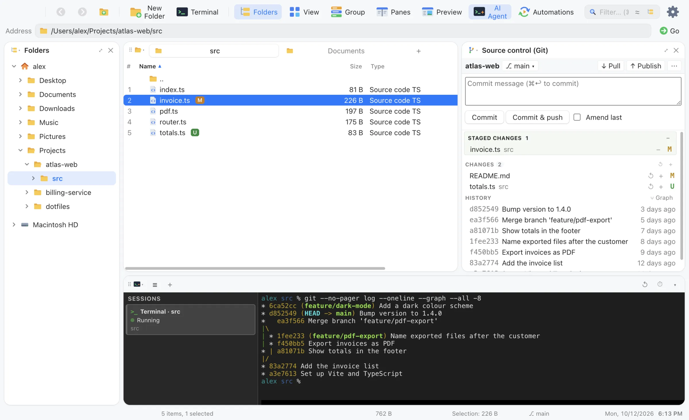
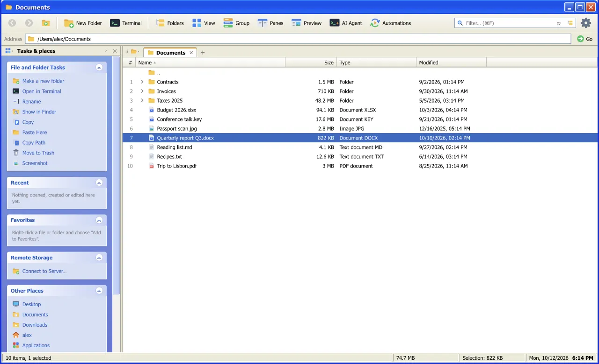
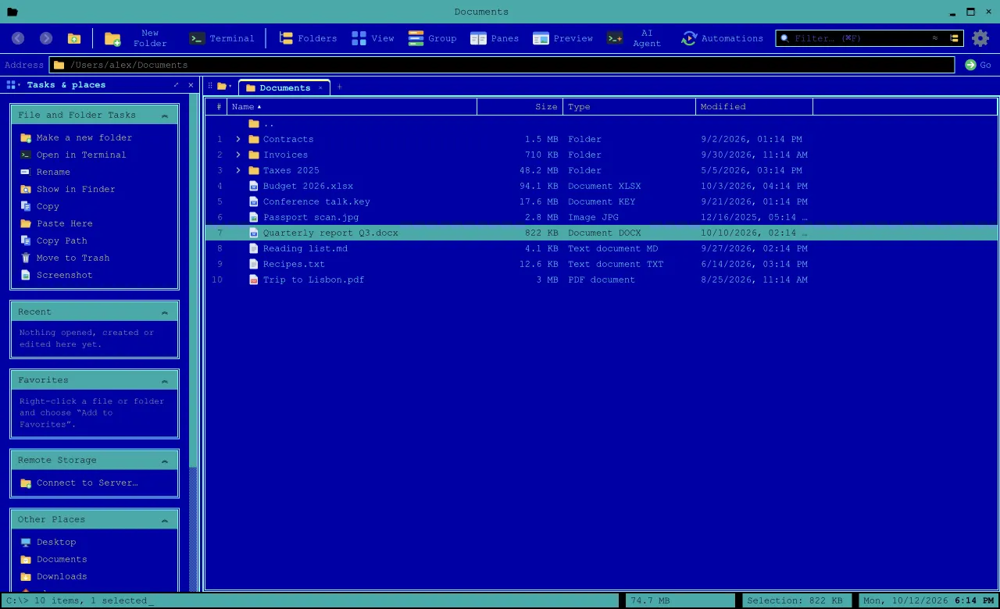
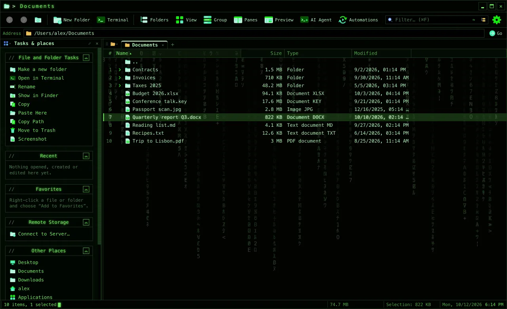

<div align="center">



# aFinder

**Explorer as you remember it. Built for how you work now.**

A fast, keyboard-driven file manager for macOS, Windows and Linux: tabs and split panes, a preview with the VS Code editor, git, archives, SFTP, S3 and SharePoint, Claude Code and Codex beside your files. In a modern macOS look, Windows XP, or nine others.

[](https://github.com/DanielHromadka/afinder-downloads/releases/latest)
[](https://github.com/DanielHromadka/afinder-downloads/releases)
[](https://github.com/DanielHromadka/afinder/actions/workflows/ci.yml)
[](LICENSE)
<br>
[](#download)
[](https://www.electronjs.org/)
[](https://www.typescriptlang.org/)
[](https://react.dev/)

[**Download**](#download) · [Website](https://afinder.pages.dev/) · [Release notes](https://github.com/DanielHromadka/afinder-downloads/releases/latest) · [Report a bug](https://github.com/DanielHromadka/afinder/issues/new) · [Čeština](README.cs.md)



</div>

## Download

Free for macOS, Windows and Linux. These links always point to the latest release.

| Platform | Download |
|---|---|
| **macOS** · Apple silicon | [aFinder-arm64.dmg](https://github.com/DanielHromadka/afinder-downloads/releases/latest/download/aFinder-arm64.dmg) |
| **macOS** · Intel | [aFinder-x64.dmg](https://github.com/DanielHromadka/afinder-downloads/releases/latest/download/aFinder-x64.dmg) |
| **Windows** · x64 | [aFinder-Setup-x64.exe](https://github.com/DanielHromadka/afinder-downloads/releases/latest/download/aFinder-Setup-x64.exe) |
| **Linux** · x64 | [AppImage](https://github.com/DanielHromadka/afinder-downloads/releases/latest/download/aFinder-x86_64.AppImage) · [.deb and .rpm](https://github.com/DanielHromadka/afinder-downloads/releases/latest) |
| **Linux** · arm64 | [AppImage](https://github.com/DanielHromadka/afinder-downloads/releases/latest/download/aFinder-arm64.AppImage) · [.deb and .rpm](https://github.com/DanielHromadka/afinder-downloads/releases/latest) |

aFinder updates itself: it asks first, then downloads, installs and restarts. The macOS build is signed and notarized. The Windows installer is not signed yet, so SmartScreen may warn on the first start (*More info → Run anyway*). On Linux, make the AppImage executable (`chmod +x aFinder-*.AppImage`).

## Features

### Working with files
- **Up to four panes, each with tabs.** Copy across with <kbd>F5</kbd>, move with <kbd>F6</kbd>, drag tabs between panes and windows, keep layouts as workspaces.
- **Command palette** (<kbd>⌘K</kbd> / <kbd>Ctrl+K</kbd>): actions, places, favourites and themes in one fuzzy list.
- **Instant filter and recursive search** that streams results while you type, ignoring case and diacritics.
- **Batch rename** with text, regular expressions or numbering, and a live preview that catches collisions first.
- **Archives as folders**: open `.zip`, `.tar.gz` and `.tar.zst` like any folder; pack a selection as ZIP, TAR.GZ or Zstandard.
- **Folder sizes** computed in the background, grouping into virtual folders, favourites, recent files.

### Preview and editing
- Code and text in **Monaco**, the editor from VS Code, with syntax colours; edit in place and save.
- Word, Excel, PDF, images, video and audio; anything else through Quick Look. An image editor with arrows, text, crop and pixelate.

### Servers and clouds
- **SFTP**, **Amazon S3** and compatible services (MinIO, Cloudflare R2, Wasabi, Backblaze B2), **SharePoint and OneDrive** through Microsoft Graph, all as ordinary folders.
- **Another computer with aFinder**: browse its files and control its screen, end-to-end encrypted.

### For developers
- **Git**: status badges in the file list, staging, commit, push, pull, rebase and stash, side-by-side diffs and a branch graph.
- **Claude Code, Codex and OpenCode** in an area beside the file list; changes they make show up immediately.
- **Automations**: describe a task, Claude Code drafts a script and a separate check; runs need no AI after that.
- **MCP server** so your agents see the folder and files you have selected (local only, token-protected, read-only unless you allow changes).
- Integrated terminal, Docker area, Task Manager, and a toolbox (checksums, duplicates, disk map, regex, unit converter…).

### Make it yours
- **Eleven themes**: Modern macOS, Windows XP, Classic, DOS, Matrix, J.A.R.V.I.S., Cyberpunk, FBI, Batman, Bitcoin and Barbie.
- Every shortcut can be rebound. Finder conventions on the Mac, Explorer conventions on Windows and Linux.
- English, Czech, German and Spanish.

<table>
  <tr>
    <td></td>
    <td></td>
    <td></td>
  </tr>
  <tr>
    <td align="center">Windows XP</td>
    <td align="center">DOS</td>
    <td align="center">Matrix</td>
  </tr>
</table>

The complete feature reference, with every shortcut, is in Czech in [README.cs.md](README.cs.md).

## Privacy

- **AI features start switched off.** Activity history, semantic search, the file assistant and the MCP server wait until you turn them on.
- **Models download only on request**, pinned to exact versions, and run offline on your machine.
- **Secrets stay in the system keychain.** Server passwords, keys and sign-in tokens are stored encrypted by the OS.
- Feedback is sent only when you press *Send*.

## Building from source

Requirements: [Node.js](https://nodejs.org/) 24 and git. Native modules (`node-pty`) need the usual build tools for your platform (Xcode Command Line Tools, Visual Studio Build Tools, or `build-essential`).

```bash
git clone https://github.com/DanielHromadka/afinder.git
cd afinder
npm install
npm run dev          # start with hot reload
```

```bash
npm run typecheck    # strict TypeScript, the main gate
npm run lint         # React hooks rules
npm test             # unit tests (vitest)
npm run dist         # macOS .dmg (arm64 + x64) into dist/
npm run dist:win     # Windows installer
npm run dist:linux   # AppImage, .deb and .rpm (build on Linux)
```

Smoke tests run the built app in a real Electron: `npm run test:tools`, `test:workspace`, `test:tour`, `test:docker` and others listed in [CLAUDE.md](CLAUDE.md).

## Project structure

```
src/main/        Electron main process: windows, IPC handlers, services (file system, VFS, git, remote, …)
src/preload/     typed window.api exposed through contextBridge
src/renderer/    React UI (contextIsolation, sandbox, no nodeIntegration)
src/workers/     utility processes: folder sizes, search, tools, system monitor, ML models
src/shared/      types, IPC contract, i18n dictionaries and pure, tested logic
mobile/          phone companion: Expo app and Cloudflare relay
feedback/        Cloudflare Worker for in-app feedback
native/          Rust input helper for remote desktop
website/         afinder.pages.dev
```

[CLAUDE.md](CLAUDE.md) describes the architecture and conventions in detail.

## Contributing

Bug reports, ideas and pull requests are welcome.

1. Open an [issue](https://github.com/DanielHromadka/afinder/issues) first for larger changes, so we can agree on the approach.
2. Keep pull requests focused and make sure `npm run typecheck`, `npm run lint` and `npm test` pass.
3. User-facing text goes through `t()`: add the key to `src/shared/i18n/cs.ts` and to the English, German and Spanish dictionaries.

New translations and themes are especially welcome; see *Conventions* in [CLAUDE.md](CLAUDE.md).

## Security

Please report vulnerabilities privately, as described in [SECURITY.md](SECURITY.md), not in public issues.

## License

aFinder is free software under the [GNU General Public License v3.0 or later](LICENSE).

Doom is not part of aFinder: doomgeneric (GPLv2) and Freedoom (BSD) are downloaded separately, only when you press *Download*.

aFinder is not affiliated with Microsoft or Apple. Windows XP and Finder are their trademarks.
